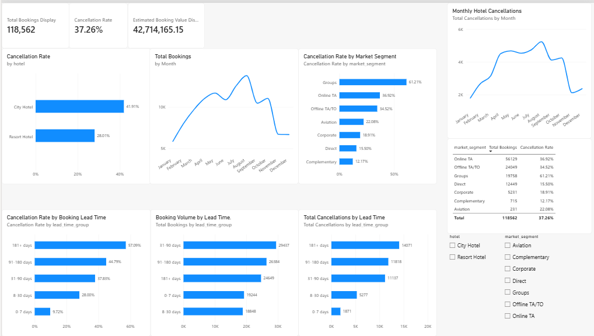
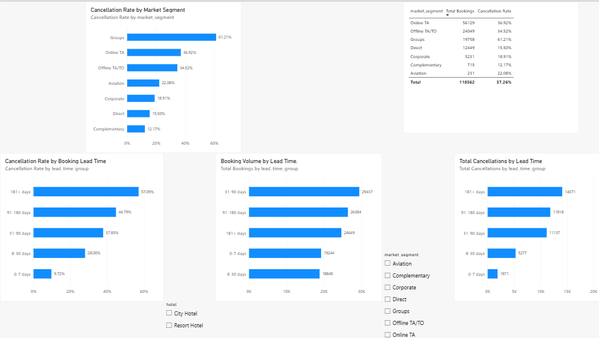
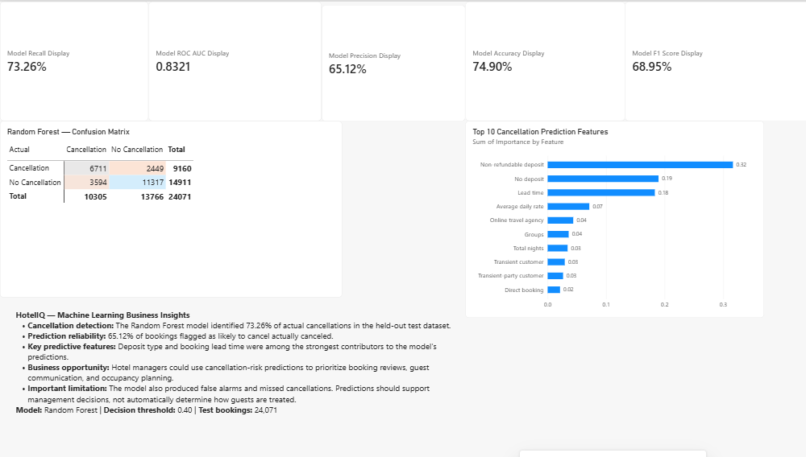

# 🏨 HotelIQ
### Hotel Revenue, Demand & Cancellation Intelligence

**An end-to-end hotel booking analytics project combining Python, PostgreSQL, Power BI, and machine learning to uncover cancellation patterns, understand booking demand, and support data-driven hotel management decisions.**

## 🌐 Live Interactive Dashboard

[**Launch HotelIQ Interactive Dashboard**](https://hoteliq-analytics.streamlit.app/)

Explore hotel booking trends, cancellation rates, market segments, and machine learning evaluation results through interactive filters.

**Online Dashboard:** Streamlit Community Cloud  
**Original BI Dashboard:** Microsoft Power BI

## 📌 Project Overview

Hotel booking cancellations can create operational uncertainty, disrupt occupancy planning, and affect potential revenue.

HotelIQ analyzes historical hotel bookings to answer important business questions:

- How frequently are hotel reservations canceled?
- Which hotel types and customer segments have higher cancellation rates?
- How does booking lead time affect cancellation risk?
- How does demand change over time?
- Can machine learning help identify bookings with a higher probability of cancellation?

The project includes data preparation, exploratory analysis, SQL analysis, an interactive Power BI dashboard, and a Random Forest classification model.

## 📊 Dataset

The project uses the **Hotel Booking Demand** dataset.

| Description | Value |
|---|---|
| Original records | 119,390 |
| Cleaned analysis records | 118,564 |
| Records excluded by cleaning rules | 826 |
| Hotel types | City Hotel and Resort Hotel |
| Target variable | `is_canceled` |
| Cleaned dataset | `data/HotelIQ_SQL_Ready.csv` |

Exact duplicate rows were retained because the source data does not provide a verified unique booking identifier.

**Dataset source:** [Hotel Booking Demand on Kaggle](https://www.kaggle.com/datasets/jessemostipak/hotel-booking-demand)

**Original researchers:** Nuno António, Ana de Almeida, and Luís Nunes (2019).

**License:** [Creative Commons Attribution 4.0 International](https://creativecommons.org/licenses/by/4.0/).

This project uses a modified version of the dataset. Cleaning, feature engineering, analysis, and modeling were performed for HotelIQ. The original researchers do not endorse this project.

## 🛠️ Technologies Used

| Technology | Purpose |
|---|---|
| Python | Data cleaning, analysis, feature engineering, machine learning |
| Pandas and NumPy | Data processing |
| Matplotlib and Seaborn | Exploratory visualizations |
| Scikit-learn | Logistic Regression and Random Forest |
| PostgreSQL 18 | SQL analysis and database views |
| Power BI | Interactive business intelligence dashboard |
| Streamlit | Public interactive web dashboard with dynamic filters, KPIs, and charts |
| Google Colab | Python notebook development |
| GitHub | Project documentation and version control |

## 🔍 Key Business Findings

### 1. Overall cancellation rate

Across 118,564 cleaned booking records:

- **44,176 bookings were canceled.**
- **37.26% overall cancellation rate.**
- **74,388 bookings were not canceled.**

### 2. Hotel type comparison

| Hotel type | Cancellation rate |
|---|---:|
| City Hotel | 41.91% |
| Resort Hotel | 28.01% |

City Hotel bookings exhibited a higher cancellation rate than Resort Hotel bookings.

### 3. Lead time and cancellation risk

| Booking lead time | Cancellation rate |
|---|---:|
| 0–7 days | 9.72% |
| 8–30 days | 28.00% |
| 31–90 days | 37.83% |
| 91–180 days | 44.79% |
| 181+ days | 57.09% |

In this dataset, bookings made further in advance had higher observed cancellation rates.

### 4. Market segment differences

The **Groups** segment had a cancellation rate of approximately **61.21%**, compared with **15.50%** for Direct bookings.

These differences suggest that booking channels and customer segments may be useful for identifying cancellation patterns.

### 5. Estimated booking value

The cleaned dataset contains approximately **42.71 million units of estimated booking value**.

This is an analytical estimate derived from booking records, not verified collected revenue. No currency is asserted.

## 📈 Interactive Power BI Dashboard

The dashboard includes three pages:

### Executive Overview



Shows booking volume, cancellation rates, estimated booking value, hotel comparisons, and monthly trends.

### Cancellation Drivers



Explores cancellation patterns by market segment and booking lead time, with interactive hotel and market-segment filters.

### Machine Learning Insights



Presents model evaluation metrics, the confusion matrix, feature importance, and business interpretation.

**Power BI file:** [HotelIQ Interactive Dashboard](dashboard/HotelIQ_Interactive_Dashboard.pbix)

## 🤖 Machine Learning: Cancellation Prediction

Two classification approaches were evaluated:

- Logistic Regression
- Random Forest

The final selected model was **Random Forest**, using a classification threshold of **0.40** selected on validation data.

A group-aware train/validation/test split was used to prevent identical combinations of selected model features from appearing in different splits. This reduces one form of overlap but does not independently verify that every underlying reservation is unique.

### Final Random Forest Test Results

| Metric | Result |
|---|---:|
| Accuracy | 74.90% |
| Precision | 65.12% |
| Recall | 73.26% |
| F1 Score | 68.95% |
| ROC-AUC | 0.8321 |
| Test records | 24,071 |

### Confusion Matrix

| Actual / Predicted | Not canceled | Canceled |
|---|---:|---:|
| Not canceled | 11,317 | 3,594 |
| Canceled | 2,449 | 6,711 |

The model identified approximately **73% of actual cancellations** in the held-out test set.

Important predictive features included:

- Deposit type
- Booking lead time
- Average daily rate (ADR)
- Market segment
- Length of stay
- Customer type

Feature importance indicates model reliance, not proof that a feature causes cancellations.

**Model outputs:**
- [Final Model Metrics](data/HotelIQ_Final_Model_Metrics.csv)
- [Feature Importance](data/HotelIQ_Feature_Importance.csv)

## 🗄️ SQL Analysis

The cleaned dataset was imported into PostgreSQL 18.

**Database:** `hoteliq_db`  
**Table:** `public.bookings`

SQL analysis included booking volumes, cancellation rates, hotel performance, monthly cancellation trends, and database views.

Available SQL scripts:

- [Hotel Performance View](sql/HotelIQ_Hotel_Performance.sql)
- [Monthly Cancellations View](sql/HotelIQ_Monthly_Cancellations.sql)

## 📁 Repository Structure

```text
HotelIQ/
├── README.md
├── notebooks/
│   ├── README.md
│   └── HotelIQ_Data_Analysis.ipynb
├── sql/
│   ├── README.md
│   ├── HotelIQ_Hotel_Performance.sql
│   └── HotelIQ_Monthly_Cancellations.sql
├── dashboard/
│   ├── README.md
│   └── HotelIQ_Interactive_Dashboard.pbix
├── data/
│   ├── README.md
│   ├── HotelIQ_SQL_Ready.csv
│   ├── HotelIQ_Final_Model_Metrics.csv
│   └── HotelIQ_Feature_Importance.csv
└── images/
    ├── README.md
    ├── HotelIQ_Executive_Overview.png
    ├── HotelIQ_Cancellation_Drivers.png
    └── HotelIQ_Machine_Learning_Insights.png
```

## ▶️ Explore the Project

1. Open `notebooks/HotelIQ_Data_Analysis.ipynb` in Google Colab to explore the Python analysis and modeling workflow.
2. Review the SQL scripts in the `sql/` folder.
3. Open `dashboard/HotelIQ_Interactive_Dashboard.pbix` using Power BI Desktop.
4. Explore the cleaned dataset and model outputs in the `data/` folder.

Some notebook steps may require the original dataset and installed Python dependencies.

## 💡 Business Applications

HotelIQ demonstrates how hotel managers could use historical booking data to:

- Identify high-cancellation booking segments.
- Investigate booking lead-time patterns.
- Support occupancy and staffing planning.
- Prioritize reservations for proactive confirmation or customer communication.
- Evaluate potential cancellation risk with predictive modeling.

Model predictions should support human decisions, not automatically determine customer treatment.

## ⚠️ Limitations

- Findings are based on historical records and may not generalize to other hotels or future periods.
- The data does not provide a verified unique reservation identifier.
- Estimated booking value is not actual realized revenue.
- Predictive performance requires further testing before operational deployment.
- The dataset is observational, so correlations do not establish causation.

## 🎯 Project Outcome

HotelIQ demonstrates an end-to-end analytics workflow: transforming raw hotel booking data into SQL-ready records, extracting business insights, building an interactive dashboard, and evaluating a machine-learning model for cancellation prediction.

The project is intended as a **data analytics and business intelligence portfolio project**.
